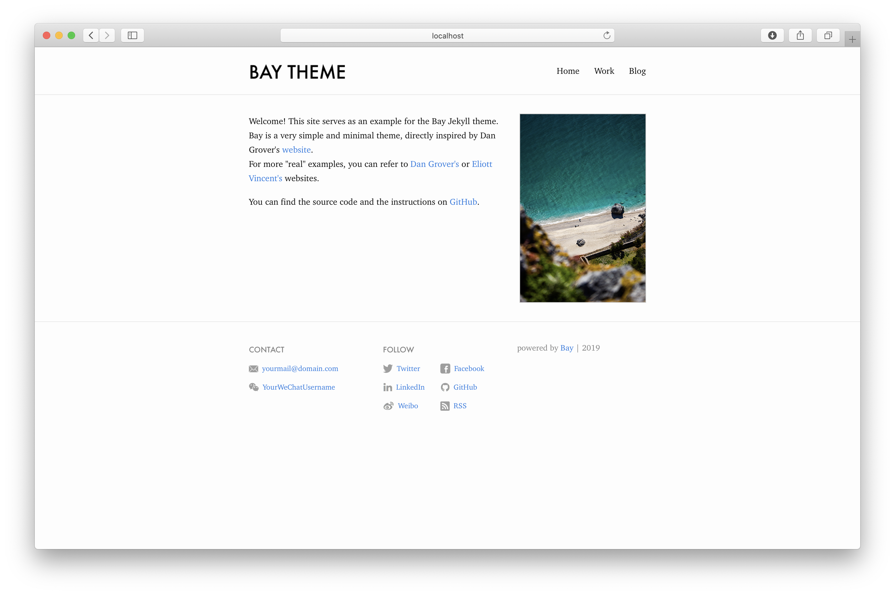

# Bay

[](https://rubygems.org/gems/bay_jekyll_theme)
[](https://rubygems.org/gems/bay_jekyll_theme)

Bay is a simple theme for Jekyll. [[view live]](https://eliottvincent.github.io/bay)

Current theme used at [elio.tt](http://elio.tt/).




## Table of contents

1. [Installation](#installation)
2. Website sections
    1. [Header](#header)
    2. [Footer](#footer)
    3. [Home page](#home-page)
    4. [Collection page](#collection-page)
    5. [Work page](#work-page)
    6. [Blog page](#blog-page)
3. [Migrating from Bay 1.x](#migrating-from-bay-1x)
4. [GitHub Pages](#github-pages)
5. [Development instructions](#development)


### Installation

The easiest solution is to [fork this repo](https://github.com/eliottvincent/bay/fork).
If you want to start from a clean website, follow the steps below:

Create a new Jekyll website:
```
jekyll new mysite
```

Open `Gemfile` and replace the line:
```
gem "minima"
```
with:
```
gem "bay_jekyll_theme"
```

Open `_config.yml` and replace the line:
```
theme: minima
```
with:
```
theme: bay_jekyll_theme
```
or, for GitHub Pages:
```
remote_theme: eliottvincent/bay
```

Finally, install the dependencies:
```
bundle install
```

and build the website!
```
jekyll serve
```


The website will look somewhat empty at first. That's normal. Follow the next instructions to complete the header and footer components, and the home and blog pages.

#### Header

Open the `_config.yml` file and add the following:
```yml
header:
  pages:
    - name: Home
      slug: /     # <-- index.md
    - name: Blog  # <-- blog.md
    - name: Whatever  # <-- whatever.md
```
Re-run `jekyll serve` to see the header updated.

#### Footer

Open the `_config.yml` file and add the following:
```yml
footer:
  show_powered_by: true
  contact:
    - type: email
      name: Email
      value: yourmail@domain.com
    - type: wechat
      value: YourWeChatUsername
      link: "#"
  follow:
    - type: twitter
      name: Twitter
      link: http://twitter.com/YourTwitterUsername
      username: "@YourTwitterUsername"
    - type: facebook
      name: Facebook
      link: http://facebook.com/YourFacebookUsername
    - type: linkedin
      name: LinkedIn
      link: http://linkedin.com/in/YourLinkedInUsername
    - type: github
      name: GitHub
      link: http://github.com/YourGitHubUsername
    - type: dribbble
      name: Dribbble
      link: https://dribbble.com/YourDribbbleUsername
    - type: rss
      name: RSS
      link: /feed.xml
```
Re-run `jekyll serve` to see the footer updated.

#### Home page

Create (or edit) the `index.markdown` file and add the following:
```yml
---
layout: home
profile_picture:
  src: /assets/img/profile-pic.jpg
  alt: website picture
---

<p>
  Welcome to my site!
</p>
```

#### Collection page

Create `collection.md` to display a simple image-and-text collection:

```yml
---
layout: collection
title: Collection
slug: /collection
permalink: /collection/
items:
  - title: Collection item
    image:
      src: /assets/img/collection/example.jpg
      alt: A camera
    description: A short description of the item.
---

This is an optional introduction.
```

#### Work page

Create `work.md` with the `work` layout. The `variant` can be `timeline`
(the default) or `editorial`:

```yml
---
layout: work
title: Work
slug: /work
permalink: /work/
variant: timeline
sections:
  - title: Work
    items:
      - date_from: "2023"
        date_to: Now
        title: Example project
        description: A short description of the project.
        image:
          src: /assets/img/work/example-project/image.jpg
          alt: Example project
        link:
          label: Read more
          url: /work/example-project/
---

A selection of things I have built.
```

Dates render as a range when both `date_from` and `date_to` are present, or
as a single date when only one is set. Links and images are optional. An image
is rendered only when `image.src` is supplied, using a 16:9 timeline or 4:3
editorial frame. Group each project's images under `assets/img/work/<project-slug>/`.

When `link` is supplied, its anchor covers the entire item. Items without `link` remain
noninteractive. Store linked detail pages as regular Markdown pages under
`work/`:

```md
---
layout: post
title: Example project
permalink: /work/example-project/
---

Detailed project content.
```

This generates `/work/example-project/` without additional `_config.yml`
setup. Work details use the `post` layout without appearing in the Blog
listing or feed.

#### Blog page

```yml
Create `blog.markdown` file and add the following:
---
layout: blog
title: Blog
slug: /blog
---

This is an example of a "Blog" page, displaying a list of posts.
<br />
```


Your website is ready!

### Migrating from Bay 1.x

Bay 2.0 replaces the former `work` layout with `collection` and moves the example
page from `/work/` to `/collection/`. Update existing pages from
`layout: work` to `layout: collection`, change their route if needed, and move
their images from `assets/img/work/` to `assets/img/collection/`.

The `work` layout now owns `/work/` and uses the section-based schema shown
above. The example site exposes both variants alongside the collection:

```yml
header:
  pages:
    - name: Collection
      slug: /collection/
    - name: Work (Timeline)
      slug: /work/
    - name: Work (Editorial)
      slug: /work-editorial/
```


### GitHub Pages

You can deploy your website to GitHub Pages, but you cannot use the 1-click GitHub Pages build-and-deploy system. The issue is that the Bay theme relies on Jekyll 4.3+ (which uses a more modern Sass processor), whereas the GitHub Pages build system uses an older version of Jekyll.

However, it's fairly easy to build and deploy your website with GitHub Actions, yet use GitHub Pages to host it.

Further explanations and instructions can be found on the official [Jekyll website](https://jekyllrb.com/docs/continuous-integration/github-actions/).

You can also refer to the [`.github/workflows/deploy.yml`](https://github.com/eliottvincent/bay/blob/master/.github/workflows/deploy.yml) file in this repository.

### Development

#### Run development instance (with hot-reload)

```sh
bundle exec jekyll serve
```

#### Build and publish the gem

Simply push and tag a new version, Github Actions will handle the rest.